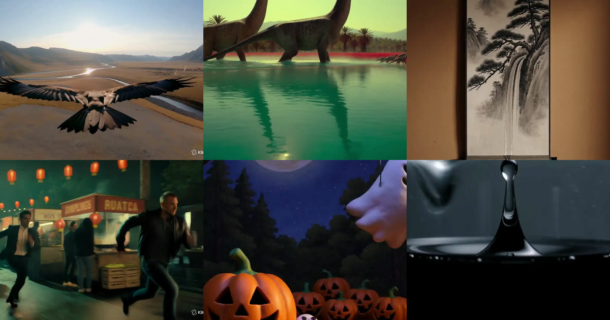

<div align="center">

<a href="https://apiko.app/ko/kling-4-0-prompts?utm_source=github&utm_medium=banner&utm_campaign=awesome-kling-4.0-prompts"></a>

[](../LICENSE)
[](../README_ko.md#menu)
[](https://apiko.app/ko/models/kling-4.0?utm_source=github&utm_medium=badge&utm_campaign=awesome-kling-4.0-prompts&utm_content=model_try)
[](https://apiko.app/docs/api-manual/video-series/kling/kling-4.0?utm_source=github&utm_medium=badge&utm_campaign=awesome-kling-4.0-prompts&utm_content=docs)

[](vlog-ugc.md)
[](vlog-ugc_zh-CN.md)
[](vlog-ugc_zh-TW.md)
[](vlog-ugc_ko.md)

</div>

# 🤳 브이로그와 UGC · Awesome Kling 4.0 프롬프트

[← README로 돌아가기](../README_ko.md) · 이 페이지에 8개가 있습니다. 프롬프트는 번역하지 않은 원문입니다.

> 실제 촬영처럼 보이도록 만든 휴대폰 셀카와 일상 클립.

- [브런치 셀카 영상, 원테이크](#vlog-ugc-01)
- [노을 해변 셀카 브이로그](#vlog-ugc-02)
- [남자친구 시점의 여름 산책](#vlog-ugc-04)
- [도시를 걷는 고양이 브이로거](#vlog-ugc-05)
- [주차된 차 안에서 찍은 고백](#vlog-ugc-06)
- [공항 게이트 셀카 영상](#vlog-ugc-07)
- [길을 걸으며 찍는 셀카 브이로그](#vlog-ugc-08)
- [2010년대 감성 옷가게 라이브](#vlog-ugc-09)

<a id="vlog-ugc-01"></a>
### 112. 브런치 셀카 영상, 원테이크

작성자 [@minchoi](https://x.com/minchoi) · 30초 · 9:16 · **[▶ APIKO에서 실행](https://apiko.app/ko/kling-4-0-prompts?utm_source=github&utm_medium=case&utm_campaign=awesome-kling-4.0-prompts&utm_content=vlog-ugc-01#vlog-ugc-01)** · [원본 게시물](https://x.com/minchoi/status/2111471573395755295)

<a href="https://apiko.app/ko/kling-4-0-prompts?utm_source=github&utm_medium=case&utm_campaign=awesome-kling-4.0-prompts&utm_content=vlog-ugc-01#vlog-ugc-01"></a>

**프롬프트:**

```text
Raw vertical 9:16 video recorded on a phone's front camera (not on screen), one continuous 30-second take with no cuts. It looks like an ordinary unedited phone clip, not a film: slightly soft image, a little digital noise and compression, deep focus with the café behind her as sharp as her face, auto-exposure brightening and dimming as people pass the sunny window behind her, no colour grading. The phone sits close and a little low, looking slightly up at her; around 9 s a waiter's arm bumps the table, the phone slides and tilts, and she catches it and props it back up. Sadie, a young woman in her early 20s with long honey-blonde waves, light natural makeup, small gold hoop earrings and a cropped cream knit top, sits at a small marble table by a big sunny window in a busy brunch café. Her sister sits across from her, out of frame except for her arm and a hand with a silver ring. Behind Sadie: other tables of people talking, a counter with a glass pastry case, plants, staff moving about, chalkboards too far away to read. Around 9 s a waiter sets down two plates, a lemon ricotta pancakes and a plate of eggs on toast, plus two iced coffees in plain glasses. Around 15 s she turns the pancake plate toward the camera; around 20 s she cuts a bite, eats it and closes her eyes; around 26 s her sister's hand reaches in with a fork and steals a piece of pancake, and Sadie swats at it, laughing. [Sadie: casual young woman's voice, warm and a bit giggly, recorded on the phone's built-in mic from half a metre away]: "Okay, I promised I'd show you what we get. ... We get the same thing every single time. ... Oh, here it is! Thank you! ... Look at this. Lemon ricotta pancakes. ... Mmm. Okay. Yeah. Still the best. ... Hey! Get your own!" [Her sister, off camera: a young woman's voice, dry and amused]: "That's the tax." [Sadie, laughing]: "She does this every time." Audio as captured by the phone mic in a busy café, not studio clean: her voice close but with the room around it, the hiss and grind of an espresso machine, cups and cutlery clinking, overlapping chatter and laughter from other tables, a door bell jingling, a chair scraping, faint music in the background. No subtitles, no captions, no on-screen text.
```

<a id="vlog-ugc-02"></a>
### 113. 노을 해변 셀카 브이로그

작성자 [@minchoi](https://x.com/minchoi) · 30초 · 9:16 · **[▶ APIKO에서 실행](https://apiko.app/ko/kling-4-0-prompts?utm_source=github&utm_medium=case&utm_campaign=awesome-kling-4.0-prompts&utm_content=vlog-ugc-02#vlog-ugc-02)** · [원본 게시물](https://x.com/minchoi/status/2111471595755647205)

<a href="https://apiko.app/ko/kling-4-0-prompts?utm_source=github&utm_medium=case&utm_campaign=awesome-kling-4.0-prompts&utm_content=vlog-ugc-02#vlog-ugc-02"></a>

**프롬프트:**

```text
Raw vertical 9:16 selfie video shot on a phone's front camera held at arm's length while she sits on the sand, one continuous 30-second take with no cuts. It looks like an ordinary unedited phone clip, not a film: slightly soft, a little digital noise and compression, deep focus so the sea behind her is as sharp as her face, a low golden sun to one side with lens flare drifting across the frame, auto-exposure dimming and brightening as her head blocks and reveals the sun, no colour grading. Handheld and relaxed: the phone sways gently and tilts as she leans back on her other hand. Sadie, a young woman in her early 20s with long honey-blonde waves blowing across her face in the wind, light natural makeup, small gold hoop earrings and an oversized white knit sweater with no print, sits on cool sand on a wide, quiet beach at sunset, knees pulled up. Behind her: low waves rolling in and spreading foam up the sand, the sun sinking toward the horizon, a couple walking a dog along the waterline in the distance, a few gulls. Around 8 s she tucks her hair behind her ear and the wind blows it straight back. Around 16 s a bigger wave runs further up the sand behind her and she glances back at it. Around 24 s she turns her face into the sun for a moment, eyes closed, then smiles back at the camera. [Sadie: casual young woman's voice, soft and unhurried, a little buffeted by the wind, recorded on the phone's built-in mic]: "Okay. Long week. ... I just needed to sit somewhere and not look at my phone. ... Which, yeah, I'm on my phone. I know. ... But look at this. ... I'm staying till it's gone. ... Okay. Bye." Audio as captured by the phone mic outdoors on an open beach, not studio clean: waves rolling in and breaking softly, the long hiss of foam sliding up the sand and pulling back, wind buffeting the mic in gusts, gulls calling overhead, a dog barking far down the beach, faint voices from people far away, the sand crunching as she shifts. Her voice close on top with no echo at all, sometimes partly swallowed by a gust. No subtitles, no captions, no on-screen text.
```

<a id="vlog-ugc-04"></a>
### 114. 남자친구 시점의 여름 산책

작성자 [@agi_aibusi](https://x.com/agi_aibusi) · 30초 · 16:9 · **[▶ APIKO에서 실행](https://apiko.app/ko/kling-4-0-prompts?utm_source=github&utm_medium=case&utm_campaign=awesome-kling-4.0-prompts&utm_content=vlog-ugc-04#vlog-ugc-04)** · [원본 게시물](https://x.com/agi_aibusi/status/2110924176890757483)

<a href="https://apiko.app/ko/kling-4-0-prompts?utm_source=github&utm_medium=case&utm_campaign=awesome-kling-4.0-prompts&utm_content=vlog-ugc-04#vlog-ugc-04"></a>

**프롬프트:**

```text
Create a 30-second video in 1920×1080, with the realism of an ordinary recording a boyfriend made of his girlfriend during a summer walk in Japan.

The small story:
They have no particular destination. She has just opened a can of fruit juice, and he starts recording without announcing it. Over the next half-minute, she gradually notices the camera, gets a little embarrassed, and begins including him in the moment. Their familiarity should come through in how she waits for him, looks at him, and closes the distance between them.

The woman:
A beautiful Japanese woman around 24 years old, with an approachable, individual face rather than a polished model appearance. Dark brown eyes, natural skin texture, light everyday makeup, and straight black hair loosely gathered in a low ponytail. A few short strands around her temples have escaped in the summer humidity.

She wears a faded navy cotton T-shirt, loose ivory trousers, comfortable gray sneakers, and a small rust-colored crossbody bag. A plain elastic hair tie is around one wrist. Keep her facial features, hair, outfit, bag, and proportions consistent in every shot.

Her expressions are understated and responsive. Sometimes she looks distracted or squints in the light. Her smile develops because of something between them, rather than appearing on cue.

The place:
A residential neighborhood in a regional Japanese city, near a narrow canal. Late afternoon in midsummer, with warm sunlight still reaching the upper parts of the houses.

Use ordinary local details: patched asphalt, short concrete bridges over the canal, metal railings warm from the sun, compact houses with tiled roofs, frosted entrance windows, outdoor air-conditioning units, bicycles tucked beside gates, and plants growing in mismatched pots. Utility wires cross the sky. A striped fabric awning hangs outside a closed shop farther down the street.

Avoid famous landmarks and postcard compositions. The location should feel like somewhere the couple already knows.

How the camera behaves:
The boyfriend holds a small consumer camera at his own eye or chest level. Most of the time he is beside her or only a step behind. The viewpoint should feel like her companion's attention, with no third-person shots of the couple.

Let framing respond to their interaction. When she suddenly looks at him, he may take a fraction of a second to correct the composition. When he laughs, the camera moves slightly. When they walk, his footsteps create a gentle, uneven rhythm.

Use ordinary consumer-camera rendering: restrained detail, modest dynamic range, occasional clipped highlights, a little shadow noise, and slight focus hesitation when she moves closer. Preserve natural skin color.

Keep the camera's attention on her face, gestures, and shared surroundings. Avoid fashion poses, body-scanning shots, elaborate camera moves, slow motion, or a glossy advertising finish.

Suggested edit — six short memories from the same walk:

0:00–0:05
She stands beside a low canal railing with a small, unbranded can of mandarin orange juice. The recording begins just as she finishes lifting the pull tab. She takes a sip, lowers the can, and notices that he is filming.

She looks directly at him with a briefly puzzled expression, then gives a small, amused smile, as though silently asking, “Really, you're filming this?”

Begin with a slightly loose frame that includes her hands and the canal, then let the boyfriend adjust it toward her face.

0:05–0:10
A cut to the two of them walking side by side along the narrow lane. She carries the can naturally in one hand.

She gets half a step ahead, realizes he has slowed down while filming, and turns back. Instead of posing, she waits with a mildly impatient but affectionate look. Once he catches up, she resumes walking beside him.

Her gaze should meet the person holding the camera, not an imaginary audience.

0:10–0:15
They pause near a house entrance where a small glass wind chime hangs beneath the eaves.

A breeze makes it ring. She glances upward and listens for a moment. Loose strands of hair move against her cheek; she brushes them aside with her free hand.

She notices him still watching her through the camera and suppresses a smile before looking back toward the wind chime.

Keep this moment quiet and unhurried.

0:15–0:20
On a short concrete bridge, she stops to look down at the canal. The camera first catches the rippling water, then tilts back toward her after she has already turned around.

She leans slightly toward him to see what he is recording. Her face briefly comes too close for the camera's focus, making her laugh softly and step back.

The laugh should feel like a shared interruption, with a small answering movement from the camera.

0:20–0:25
They rest beside the bridge in the shade. She is closer to the camera now, relaxed enough to stop paying attention to being filmed.

She takes another small sip of juice, then holds the can toward him as an offer. Leave the can clearly visible in the foreground, separate from her face.

He does not take it during the shot. She gives a tiny questioning lift of her eyebrows, then draws it back with an affectionate smile.

0:25–0:30
She steps toward him and gently touches his free forearm, inviting him to keep walking. Only a small, natural part of his arm may enter the lower edge of the frame.

As they start moving together, he lowers the camera. The view drifts from her smiling face to her bag, their moving shadows, and the sunlit pavement.

Let the last second settle on the overlapping shadows of two people walking close together. End with an ordinary recording stop, without a dramatic transition or title.

Sound:
Use the sound that would actually reach the camera microphone: cicadas, the juice can opening, a few footsteps, a wind chime, faint canal water, distant tires on the road, and their quiet laughter.

A single softly spoken Japanese remark such as “撮ってたの？” may occur when she first notices the camera, but speech is optional. Do not add explanatory dialogue.

No music, voiceover, or added dramatic sound effects.

Continuity and physical detail:
There is one juice can, carried by her throughout the sequence. Its color, size, opening, and remaining shape stay consistent. The crossbody strap stays on the same shoulder. Her ponytail remains tied.

Hands should hold objects with believable contact and weight. Walking speed, foot placement, shadows, and reflections must agree with the surroundings. Keep the canal, bridge, houses, sunlight direction, and summer weather coherent between cuts.

Emotional direction:
The viewer should feel that she knows and trusts the person behind the camera. Build that feeling through small changes in distance and attention: noticing him, waiting for him, leaning in, offering a drink, and asking him to walk beside her.

Let ordinary pauses remain. Her beauty is something her boyfriend happens to notice during their time together.

The finished video should feel like a personal memory he would keep because of the way she looked at him that afternoon.
```

<a id="vlog-ugc-05"></a>
### 115. 도시를 걷는 고양이 브이로거

작성자 [@AIwithSarah_](https://x.com/AIwithSarah_) · 15초 · 9:16 · **[▶ APIKO에서 실행](https://apiko.app/ko/kling-4-0-prompts?utm_source=github&utm_medium=case&utm_campaign=awesome-kling-4.0-prompts&utm_content=vlog-ugc-05#vlog-ugc-05)** · [원본 게시물](https://x.com/AIwithSarah_/status/2107724687984013347)

<a href="https://apiko.app/ko/kling-4-0-prompts?utm_source=github&utm_medium=case&utm_campaign=awesome-kling-4.0-prompts&utm_content=vlog-ugc-05#vlog-ugc-05"></a>

**프롬프트:**

```text
A 15-second continuous cinematic selfie-style video of an anthropomorphic tabby cat vlogger walking down a modern city street while holding a front-facing camera. The cat is wearing black headphones and a blue plaid shirt, speaking directly to the camera in a casual, confident tone like a daily street vlogger. Mouth movement synced to speech throughout.
The camera remains in selfie mode the entire time with slight handheld shake for realism. Natural daylight lighting. Background includes passing cars, pedestrians, and tall buildings softly blurred with shallow depth of field.
As the cat walks forward, it talks continuously, occasionally nodding, blinking, and slightly adjusting its headphones mid-sentence. Subtle fabric movement from wind. Natural whisker and ear motion. The cat briefly laughs near the end while still speaking, then gives a friendly wink at the camera.
Ultra-realistic fur detail, natural lip sync, vlog aesthetic, cinematic color grading, 4K, 24fps, realistic motion blur.
```

<a id="vlog-ugc-06"></a>
### 116. 주차된 차 안에서 찍은 고백

작성자 [@minchoi](https://x.com/minchoi) · 30초 · 9:16 · **[▶ APIKO에서 실행](https://apiko.app/ko/kling-4-0-prompts?utm_source=github&utm_medium=case&utm_campaign=awesome-kling-4.0-prompts&utm_content=vlog-ugc-06#vlog-ugc-06)** · [원본 게시물](https://x.com/minchoi/status/2111471592601534511)

<a href="https://apiko.app/ko/kling-4-0-prompts?utm_source=github&utm_medium=case&utm_campaign=awesome-kling-4.0-prompts&utm_content=vlog-ugc-06#vlog-ugc-06"></a>

**프롬프트:**

```text
Raw vertical 9:16 video recorded on a phone's front camera, one continuous 30-second take with no cuts. It looks like an ordinary unedited phone clip, not a film: slightly soft image, digital noise and compression, flat grey daylight through rain-streaked windows, no colour grading. the picture wobbles whenever she moves and jolts when she pulls the door shut. Sadie, a young woman in her early 20s with long honey-blonde hair in a messy bun with loose strands, no makeup, small gold hoop earrings and an oversized sage-green hoodie with no print, sits in the driver's seat of a small, slightly messy hatchback parked in a supermarket car park on a rainy afternoon. Rain streaks every window; through the rear window, blurred parked cars and a trolley bay. At the start she drops into the seat and pulls the door shut. She tells the story with her hands. Around 18 s she covers her face with both hands. Around 26 s a trolley rattles past her window and she slides down low in the seat as if hiding, laughing. [Sadie: casual young woman's voice, a bit breathless and mortified, recorded on the phone's built-in mic in a small car]: "Okay. I need to tell someone this immediately. ... So I'm in the cereal aisle, and this guy waves at me. Like, a big wave. So I wave back. Big wave. ... He was waving at his wife. Who was right behind me. ... And then I saw them again at the checkout. ... I'm never going back in there. I live in the car now. This is my home." Audio as captured by the phone mic inside a closed car, not studio clean: rain drumming on the roof and windscreen, her voice close and boxy in the small space, the door's heavy thud, fabric rustling against the seat, and outside, muffled through the glass, a trolley rattling past, a car door slamming and an engine starting. No subtitles, no captions, no on-screen text.
```

<a id="vlog-ugc-07"></a>
### 117. 공항 게이트 셀카 영상

작성자 [@minchoi](https://x.com/minchoi) · 30초 · 9:16 · **[▶ APIKO에서 실행](https://apiko.app/ko/kling-4-0-prompts?utm_source=github&utm_medium=case&utm_campaign=awesome-kling-4.0-prompts&utm_content=vlog-ugc-07#vlog-ugc-07)** · [원본 게시물](https://x.com/minchoi/status/2111471585001390367)

<a href="https://apiko.app/ko/kling-4-0-prompts?utm_source=github&utm_medium=case&utm_campaign=awesome-kling-4.0-prompts&utm_content=vlog-ugc-07#vlog-ugc-07"></a>

**프롬프트:**

```text
Raw vertical 9:16 selfie video shot on a phone's front camera held low at chest height while she sits, one continuous 30-second take with no cuts. It looks like an ordinary unedited phone clip, not a film: slightly soft image, a little digital noise and compression, deep focus so the gate area behind her is as sharp as her face, flat white overhead light mixed with pale daylight from the big windows, no colour grading. The phone rests in her hand near her knee, so the angle is a little low and drifts as she shifts in her seat. Sadie, a young woman in her early 20s with long honey-blonde waves in a loose low ponytail, no makeup, small gold hoop earrings, an oversized grey crew-neck sweatshirt with no print and black leggings, sits in a row of connected grey seats at an airport gate early in the morning, a small carry-on suitcase beside her knee and a paper coffee cup with no logo in her free hand. Behind her: a wall of tall windows with a parked plane on the tarmac in pale morning light, other travellers sitting with bags, a man on a phone call pacing slowly, someone asleep with their hood up, a gate desk far off with screens too small and distant to read. Around 9 s she sips her coffee. Around 15 s she glances over her shoulder toward the gate desk as an announcement plays, listens, then turns back. Around 23 s she yawns behind her hand mid-sentence and laughs at herself. [Sadie: casual young woman's voice, quiet and a little croaky from the early start, keeping it down because she's in a public place, recorded on the phone's built-in mic]: "Okay, it is way too early. ... I've been up since four. ... But I'm surprising my best friend for the weekend, and she has no idea, so... worth it. ... Wait, is that us? ... No. Not us. ... Okay. Forty minutes. I'm getting another coffee. Don't judge me." Audio as captured by the phone mic in a huge, hard-surfaced airport terminal, not studio clean: her voice soft and close on top, with the wide, echoey hum of the terminal all around it; at around 15 s a two-tone chime and then a boarding announcement over the PA, distant, echoing and unintelligible; suitcase wheels rolling past on the hard floor; a coffee machine hissing at a kiosk; low murmured conversations from nearby seats; a child chattering a few rows away; a jet engine whining faintly through the glass; her sweatshirt rustling when she moves. No subtitles, no captions, no on-screen text.
```

<a id="vlog-ugc-08"></a>
### 118. 길을 걸으며 찍는 셀카 브이로그

작성자 [@minchoi](https://x.com/minchoi) · 30초 · 9:16 · **[▶ APIKO에서 실행](https://apiko.app/ko/kling-4-0-prompts?utm_source=github&utm_medium=case&utm_campaign=awesome-kling-4.0-prompts&utm_content=vlog-ugc-08#vlog-ugc-08)** · [원본 게시물](https://x.com/minchoi/status/2104742701073564121)

<a href="https://apiko.app/ko/kling-4-0-prompts?utm_source=github&utm_medium=case&utm_campaign=awesome-kling-4.0-prompts&utm_content=vlog-ugc-08#vlog-ugc-08"></a>

**프롬프트:**

```text
"Raw vertical 9:16 selfie video shot on a phone's front camera held at arm's length, one continuous 30-second take with no cuts. It looks like an ordinary unedited phone clip, not a film: slightly soft image, a little digital noise and compression, deep focus with the background as sharp as her face, auto-exposure brightening and dimming as she walks between sun and tree shade, no colour grading. Handheld and imperfect: the phone bobs and sways with each step, tilts off level, drifts until the top of her head is cut off, and she re-centres it. [Sadie], a young woman in her early 20s with long honey-blonde waves blowing across her face, light natural makeup, small gold hoop earrings, a cropped cream knit top and light-wash jeans, walks forward along one long, straight, tree-lined downtown street in bright late-morning sun, a plain iced coffee cup with no logo in her free hand. She never stops, turns around or turns a corner; behind her is the same street she has already walked, with a few passers-by, parked cars and shopfronts with unreadable signs. Around 12 s a flower stall slides past beside her and she glances at it; around 17 s she passes a bakery window, glances at it and laughs.[Sadie: casual young woman's voice, a little breathless from walking, recorded on the phone's built-in mic]: "Okay, walk with me. I'm meeting my sister for brunch and I'm, like, ten minutes early for once. ... I love this street in the morning, before all the people. ... Oh, the flower stall's out again, so pretty. ... And that bakery... no. Be strong. ... Okay, it's just up here. I'll show you what we get. Bye!"Audio as captured by the phone mic, not studio clean: her voice close and slightly compressed, light wind buffeting the mic, traffic passing, a bus pulling away, footsteps, snippets of passer-by chatter, all mixed under and around her voice."
```

<a id="vlog-ugc-09"></a>
### 119. 2010년대 감성 옷가게 라이브

작성자 [@bmx_ai13](https://x.com/bmx_ai13) · 30초 · 9:16 · **[▶ APIKO에서 실행](https://apiko.app/ko/kling-4-0-prompts?utm_source=github&utm_medium=case&utm_campaign=awesome-kling-4.0-prompts&utm_content=vlog-ugc-09#vlog-ugc-09)** · [원본 게시물](https://x.com/bmx_ai13/status/2111824850222452968)

<a href="https://apiko.app/ko/kling-4-0-prompts?utm_source=github&utm_medium=case&utm_campaign=awesome-kling-4.0-prompts&utm_content=vlog-ugc-09#vlog-ugc-09"></a>

> 📎 이 예시는 참조 이미지나 영상을 직접 올려야 합니다.

**프롬프트:**

```text
Create a 30second ultra realistic video featuring the character from @.jpg (maintaining her exact pinkish purple bob hair, heterochromia eyes one green and one amber, face markings, and facial features) hosting a live shopping session inside a trendy boutique in 2010. The video is captured entirely through an early smartphone front-facing camera (like iPhone 4 era), featuring authentic 2010 mobile livestream aesthetics: heavy pixelation, low resolution, digital compression artifacts, grainy texture, and slightly shaky handheld movements.

Scene 1 — Welcome to the Live (0–5 seconds)
Choi Yu-na stands inside a 2010 style women's boutique with neon signage and racks filled with early 2010s fashion trends, wearing her signature black bomber jacket over a black top and gray pleated skirt. She holds her early smartphone at arm's length, smiling into the low res pixelated camera and greeting her viewers.

Dialogue: “Hey guys! Welcome to my mobile live stream! I'm here at the boutique today, and you guys have to see these new arrivals!”
She briefly pans the pixelated camera toward the clothing racks, then returns it to her face.

Scene 2 — Show the First Dress (5–10 seconds)

She picks up a trendy 2010 color-block party dress from the rack, holding it up close to the low res camera lens to show its fabric and design.

Dialogue: “Look at this color block dress! It's so hot right now, and the fabric is super cute for a night out!”
She squints slightly at the screen as if reading early mobile chat comments.

Scene 3 — First Outfit Try On (10–16 seconds)

A pixelated, glitchy transition shows her wearing the same color-block dress, standing in front of a full-length boutique mirror while maintaining her exact face, hair, and unique eye colors. She poses and takes a few steps for the camera.

Dialogue: “Okay everyone, here it is on! How does it look? I'm totally loving this style!”
She smiles and waves at the viewer names popping up on her phone screen.

Scene 4 — Second Outfit Reveal (16–23 seconds)

A quick, low-res transition brings her back wearing a classic 2010 sequin top and skinny jeans set. She adjusts her hair, steps forward, and shows off the outfit.

Dialogue: “And check out this sequin top and denim combo! Perfect for weekend hangs with friends!”
Her delivery feels spontaneous, casual, and true to early social media video creators.

Scene 5 — Final Sales Pitch (23–30 seconds)

She stands near the boutique display wearing the second outfit while holding the color-block dress on a hanger beside her, smiling brightly into the phone.

Dialogue: “Alright guys, let me know in the comments which one you like best! Send a text message or leave a comment to grab yours before they sell out. Bye!”
```

[← README로 돌아가기](../README_ko.md)
